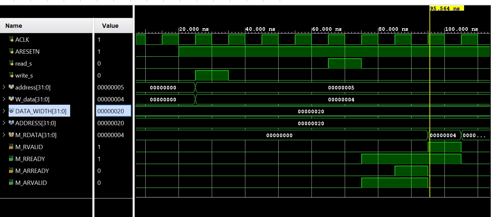
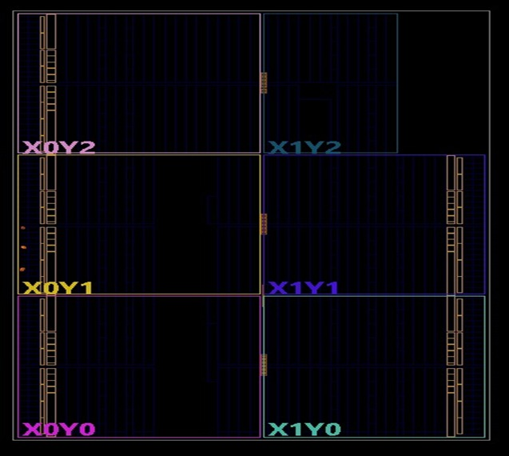
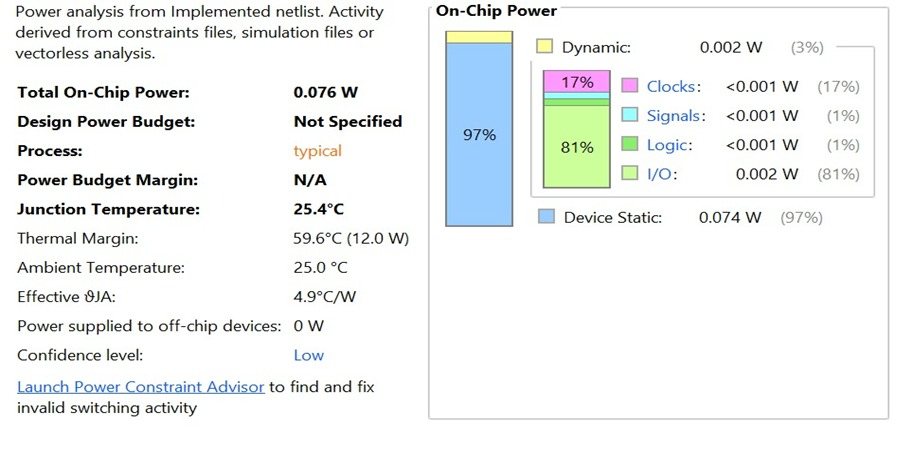
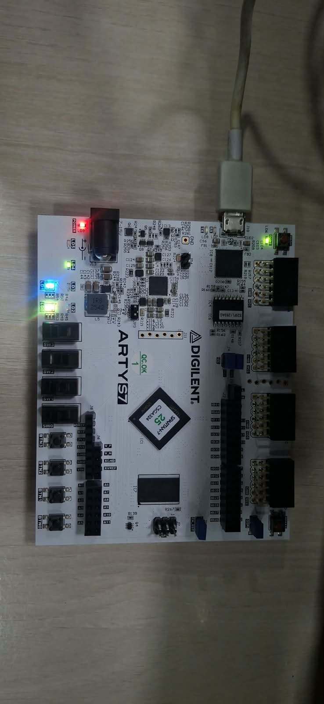

# Design and Verification of an AXI4-Lite Master-Slave Bus using SystemVerilog

## 📌 Overview
This repository contains the complete RTL design, functional simulation, and FPGA implementation of an **AXI4-Lite Master-Slave Bus Interface**. 

Developed using **SystemVerilog**, the project implements the  AXI4-Lite protocol, which is widely used for memory-mapped register access in FPGA and SoC designs. The architecture features a 32-bit address and data bus, a 32-register internal bank, and the standard 5-channel AXI interface with VALID/READY handshaking.

The design is simulated using Xilinx Vivado XSim and successfully implemented on the **Digilent Arty S7-25 (Spartan-7) FPGA board**.

## ✨ Key Features
*   **5 Independent Channels:** Implements Write Address (AW), Write Data (W), Write Response (B), Read Address (AR), and Read Data (R).
*   **VALID/READY Handshake:** Robust synchronization mechanism ensuring safe data transfer between Master and Slave.
*   **Register Bank:** 32 internal 32-bit registers inside the Slave for read/write memory-mapped operations.
*   **FSM Control:** Master uses a Finite State Machine to sequence Read and Write transactions.
*   **Hardware Verified:** Successfully synthesized, implemented, and tested on the Arty S7-25 FPGA. Timing closure achieved with 0.076 W estimated on-chip power.

## 🛠️ Tools & Hardware
*   **HDL:** SystemVerilog
*   **EDA Tool:** Xilinx Vivado 2025.1
*   **Target Board:** Digilent Arty S7-25 (Spartan-7 XC7S25)
*   **Hardware Verification:** Switch-to-LED mapping (SW0-SW3 to LD2-LD5) to verify FPGA I/O configuration.

📊 Results & Outputs

### 1. Simulation Result

The testbench performs a write operation of `Data = 4` at `Address = 5`, followed by a read operation from the same address. The waveform confirms successful data retrieval, verifying the VALID/READY handshakes.



### 2. FPGA Implementation Results

The design was synthesized and implemented on the Arty S7-25 board.
*   **Device Layout:** Placed across device regions X0Y0 to X1Y2.
*   **Timing:** Zero Total Negative Slack (TNS), all timing constraints met.
*   **Power:** Estimated total on-chip power is **0.076 W** (0.074 W static, 0.002 W dynamic).




### 3. Hardware Output

The basic I/O test maps the onboard switches to LEDs to verify correct FPGA programming.



🚀 Future Scope

Implement complete byte-strobe support using WSTRB.

Add proper address decoding and range checking.

Expand to multiple AXI4-Lite Slave peripherals.

Integrate with processor-based systems (e.g., MicroBlaze).

Add more comprehensive verification scenarios using UVM.

👨‍💻 Author

K. Abhinaya (Roll No: 2411EC010075)
Department of Electronics and Communication Engineering
School of Engineering, Malla Reddy University, Hyderabad, Telangana, India

Project Guide: Dr. Narmada Kari (Assistant Professor)

## 📂 Repository Structure
```text
├── RTL/                        # SystemVerilog Design Sources
│   ├── axi4_lite_master.sv     
│   ├── axi4_lite_slave.sv      
│   └── axi4_lite_top.sv        
├── Simulation/                 
│   └── axi4_lite_tb.sv         # Testbench for Read/Write verification
├── Constraints/                
│   └── arty_s7_25.xdc          # Pin mappings
└── Docs/                       # Project Images & Reports
